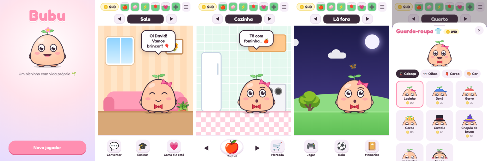

# Bubu 🌱

Um bichinho virtual fofinho, no estilo dos jogos de cuidar de pet, só que **com vida própria**: ele tem uma
rede neural de verdade, sente fome, sono, saudade e tédio, anda pela casa sozinho, pede ajuda, faz perguntas
para aprender sobre você e sobre o mundo, cresce do ovinho até a velhice e, no fim, deixa um ovinho com o que aprendeu.

É um **PWA** (site que vira app): abre no navegador do celular e pode ser instalado na tela inicial do iPhone e do Android,
sem loja. Funciona offline depois da primeira visita.



## O que já tem (v0.1)

| | |
|---|---|
| **Pré-cadastro** | Seu nome, nome do bichinho, aniversário (ele lembra e dá parabéns) e a cor do ovinho. Cada jogador tem o seu Bubu, salvo no aparelho. Dá para ter vários jogadores no mesmo celular. |
| **Ciclo de vida** | Ovo (toque para aquecer) → bebê → criança → jovem → adulto → vovô → fim. O brotinho da cabeça cresce: broto, folhinha, duas folhas, flor. Bebê fala "bubês" (com tradução embaixo). |
| **Cômodos** | Sala, cozinha, banheiro, quarto e lá fora (o céu segue a hora real). Troque com as setas ou deslizando o dedo. |
| **Cuidar** | Arraste comida até a boca, esfregue o sabonete e use o chuveiro, apague a luz para ele dormir, dê remédio quando estiver dodói. Carinho = deslizar o dedo nele. Cutucar = tocar (mas se cutucar demais ele enjoa). |
| **Guarda-roupa** | Chapéus, óculos, roupas e cores, compradas com moedas. |
| **Mini-jogos** | Pega-frutas, Pula-nuvem, Estoura-bolhas e Memória. Dão moedas e diversão (e cansam). |
| **Vida própria** | A rede neural decide quando ele passeia, brinca sozinho, cochila, pede ajuda ou faz uma pergunta. Ele continua vivendo com o app fechado (até 72 h são recuperadas ao voltar). |
| **Aprender** | Ele pergunta coisas ("qual sua cor favorita?", "o que é saudade?", "como foi seu dia?") e lembra depois. Você ensina palavras ("gato é um bichinho que mia") e truques (diz um comando e dá 👍/👎 até ele acertar). |
| **Cérebro** | No quarto, o botão 🧠 mostra a rede funcionando ao vivo. "Como ele está" mostra humor, necessidades, personalidade e o que a experiência ensinou. |
| **Voz** | Ele fala em voz alta (pode desligar no menu). No chat dá para falar pelo microfone, se o navegador permitir. |

## Como abrir no celular (o "escanear e abrir o app")

A ferramenta de escanear um QR code e abrir o app simulado no iPhone/Android é o **Expo Go**, mas ela só roda
apps feitos em React Native/Expo. O Bubu é um PWA, então **não precisa de Expo Go**: o próprio navegador do celular já
é o "simulador", e o QR code abre o jogo direto.

### Opção 1: no seu Wi-Fi (para testar enquanto programa)

```bash
npm run celular
```

Aparece um QR code no terminal. Aponte a câmera do celular (no mesmo Wi-Fi) e o Bubu abre no navegador.
Não precisa instalar nenhuma dependência para isso (só Node.js 18+).

> Pela rede local (http) o jogo funciona, mas o iPhone/Android só **instalam** como app e deixam offline quando o
> endereço é **https**. Para isso, use a opção 2.

### Opção 2: link público com HTTPS (para instalar como app)

O repositório já tem a publicação automática no **GitHub Pages** (`.github/workflows/pages.yml`):

1. No GitHub, abra **Settings → Pages** e em **Source** escolha **GitHub Actions**.
2. Faça merge na `main`. Em 1 ou 2 minutos o site fica em `https://dhqdev.github.io/Bubu/`.
3. No jogo, **☰ Menu → Abrir no celular** mostra o QR code desse endereço.
4. Instale:
   - **iPhone (Safari):** botão Compartilhar → **Adicionar à Tela de Início**.
   - **Android (Chrome):** menu ⋮ → **Instalar app**.

(GitHub Pages em repositório privado exige plano pago. Alternativa grátis: arrastar a pasta para o Netlify Drop ou
importar o repositório na Vercel; o app é só arquivos estáticos.)

### Sobre o "xtools"

O projeto mais conhecido com esse nome é o [xtool](https://github.com/xtool-org/xtool), que compila apps **nativos de iOS
em Swift** fora do Mac. Ele não serve para PWA, então a escolha foi **HTML + CSS + JavaScript puro**, sem build:
abre em qualquer celular, é fácil de publicar e, mais pra frente, dá para empacotar o mesmo código como app de loja com
[Capacitor](https://capacitorjs.com/) (iOS e Android) sem reescrever.

## Rodar e testar no computador

```bash
npm run dev     # http://localhost:5173
npm test        # testes da rede neural, da vida e da mente (node:test, sem dependências)
```

Para ver o ciclo de vida rápido: **☰ Menu → Ritmo da vida → Teste** (1 dia = 24 min).

## Como o cérebro funciona

A rede neural foi adaptada do [Pestinha](https://github.com/mille-okws/pestinha) (a versão para notebook, em Python),
reescrita em JavaScript para rodar no celular. São ~350 neurônios de integração e disparo com vazamento (LIF) e
~12 mil sinapses:

```text
necessidades e você ──► sentidos (fome, sono, sujeira, tédio, solidão, carinho, cutucada, comida, banho, bronca...)
                              │  neurônios sensoriais (Poisson), com habituação
                              ▼
         interneurônios: alerta, curiosidade, vontade de brincar, calma, sono, frustração, tristeza, medo, carência
                              │
                              ▼
   motores de expressão (feliz, curioso, bravo, triste, sonolento, assustado, sereno)  →  a carinha dele
   motores de decisão (passear, pedir ajuda, perguntar, brincar sozinho, cochilar)     →  o que ele faz
```

- **Personalidade:** cada Bubu nasce com uma fiação e ganhos diferentes (curioso, grudento, medroso, dorminhoco...).
- **Habituação:** cutucar demais perde a graça; ele passa a reclamar.
- **Aprendizado (três fatores):** o que estava acontecendo quando você deu carinho ou elogio passa a deixá-lo mais feliz;
  bronca faz o contrário. Fica salvo e passa (pela metade) para o próximo ovinho.

Arquivos: `js/brain.js` (rede), `js/life.js` (necessidades e fases), `js/mind.js` (perguntas, palavras e truques),
`js/bubu-svg.js` (desenho), `js/main.js` (telas e interação), `js/games/` (mini-jogos).

## Próximos passos sugeridos

- Conta na nuvem (login) para o Bubu acompanhar o jogador em outro celular.
- Notificações ("o Bubu está com fome") com push.
- Mais cômodos (laboratório de poções, loja), mais jogos e visitas entre Bubus de amigos.
- Empacotar com Capacitor para a App Store e a Play Store.

## Licença

GPL-3.0, a mesma do Pestinha, de onde veio a ideia e a estrutura da rede neural. O gerador de QR code
(`js/vendor/qrcode.js`, Kazuhiko Arase) é MIT. Visual e personagem do Bubu são originais.
